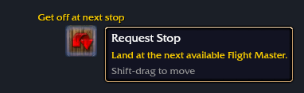

# LeaveButton

A "get off at next stop" button on flight paths in **WoW Forever**, where Blizzard's own button
doesn't appear.

| On a flight path | After clicking |
|---|---|
|  |  |

## What it does

- On a flight path, a button above your action bars lands you at the next flight master. After
  a click it reads "Landing at next stop" until you land.
- In a vehicle, the same button leaves it, but only when Blizzard's leave button isn't showing.
- It isn't a protected button, so it works in combat.
- Shift-drag it to move it; the position is saved for all your characters.
- With FlareUI's Flight Timer bar on, the button sits just left of it while you fly, beside
  the destination and time left, and follows the bar when you move it in Edit Mode. A spot
  you Shift-drag the button to wins.
- Settings: Esc > Options > AddOns > LeaveButton, or the addon compartment on the minimap.

## Commands

| Command | |
|---|---|
| `/leavebutton` | What it does and the list of commands |
| `/leavebutton move` | Shows the button now so you can place it (Shift-drag), click it when done |
| `/leavebutton reset` | Back to the default position |
| `/leavebutton beside on`, `off` | Sit beside FlareUI's Flight Timer bar while flying, or not |
| `/leavebutton settings` | Opens the settings |

## Install

Use your addon manager, or download the zip from
[Releases](https://github.com/MeioNeiz/LeaveButton/releases) and unzip it into
`World of Warcraft\_forever_\Interface\AddOns`, so that you end up with
`AddOns\LeaveButton\LeaveButton.toc`. Restart WoW fully (a `/reload` doesn't find new
addons).

No other addons needed.

## Limits

- It checks for a flight start or landing every 2 seconds as well as on events, so the button
  can take a moment to appear or go.
- Mostly tested on flight paths; vehicles are rare in WoW Forever.

## Licence

[MIT](LICENSE)
